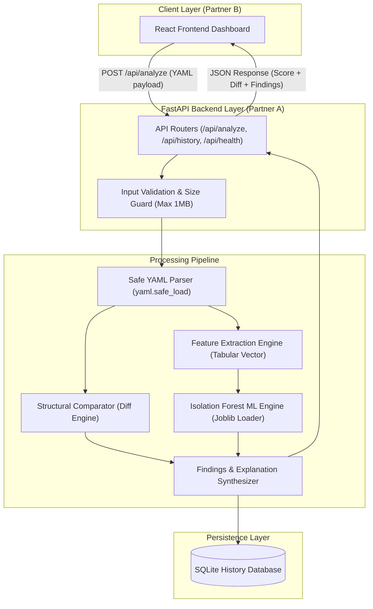

# Architecture & System Design

## 1. Overview
The **GitHub Actions Workflow Anomaly Detection System** is an analysis-only cybersecurity and machine learning platform. It inspects GitHub Actions YAML workflow files, extracts comprehensive structural and security-relevant features, identifies anomalous modifications using unsupervised machine learning (Isolation Forest), and pairs statistical outlier detection with transparent, rule-based structural diffing.

The system is designed with a strict **non-execution security model**: workflow contents and embedded shell commands are treated as untrusted data and are never executed or dispatched to GitHub.

---

## 2. High-Level Architecture

---

## 3. Subsystem Breakdown

### 3.1 Safe YAML Parser (`backend/app/parser/`)
- **Objective**: Safely parse raw YAML text into a standard Python dictionary structure.
- **Security Boundary**: Uses `yaml.safe_load()` exclusively. Disables custom Python object tags (`!!python/object`).
- **Validation**: Checks for valid GitHub Actions top-level keys (`name`, `on`, `jobs`, `permissions`, `env`). Flags syntax errors without crashing the server.

### 3.2 Structural Feature Extractor (`backend/app/features/`)
- **Objective**: Convert hierarchical workflow YAML into a flat numerical and categorical feature vector.
- **Key Metrics Extracted**:
  - Top-level workflow attributes: trigger count, default permissions.
  - Job-level metrics: total jobs, runner types (e.g., `ubuntu-latest`, self-hosted), dependencies (`needs`), timeouts.
  - Step-level metrics: total steps, external actions used, version pinning (full SHA vs. floating tag), inline `run` commands, secret references (`secrets.*`).
  - Comparative diff metrics (when a baseline workflow is provided): added/removed jobs, altered permissions, modified triggers.

### 3.3 Machine Learning Engine (`backend/app/models/`)
- **Objective**: Evaluate structural feature vectors against a model trained on authentic open-source workflows.
- **Baseline Model**: **Isolation Forest** (`scikit-learn`), ideal for identifying anomalous samples based on path length isolation in random tree ensembles.
- **Artifact Management**: Models and preprocessing pipelines (imputers, scalers) are serialized using `joblib` and loaded immutably into memory on backend startup.

### 3.4 Findings & Explanation Synthesizer (`backend/app/services/`)
- **Objective**: Bridge the gap between unsupervised ML anomaly scores and human-readable cybersecurity findings.
- **Principle**: ML identifies *that* a workflow is structurally unusual; deterministic diffing and security rules explain *why* (e.g., newly introduced unpinned action, elevated `id-token: write` permission, or suspicious runner alteration).

### 3.5 API Layer & Schemas (`backend/app/api/` & `backend/app/schemas/`)
- **Objective**: Expose clean REST endpoints conforming to the agreed API contract.
- **Validation**: Pydantic v2 schemas enforce type validation, serialization, and schema documentation for all requests and responses.

### 3.6 Storage Layer (`backend/app/storage/`)
- **Objective**: Store historical analysis records in a lightweight SQLite database for reporting and audit history.

---

## 4. Cybersecurity Threat Model

| Threat | Risk | Mitigation Strategy |
| :--- | :--- | :--- |
| **Malicious YAML Deserialization** | Remote Code Execution (RCE) on backend | Strict enforcement of `yaml.safe_load()`. Rejection of non-standard tags. |
| **Command Injection via Shell Steps** | Arbitrary command execution | Analysis-only design: workflow contents and scripts are string-analyzed via regex/AST, never passed to `subprocess`, `os.system`, or shells. |
| **Denial of Service (DoS) via Large Payloads** | Server CPU / memory exhaustion | Strict payload size limits (e.g., maximum 1 MB per workflow file) and parsing timeouts. |
| **Data Leakage in ML Pipeline** | Over-optimistic model evaluation | Grouping original workflows and their modified variants together during train/test splits. |
| **Misleading ML Interpretation** | False sense of security or excessive alarms | Distinguish statistical outlier scores from deterministic security findings. No uncalibrated "maliciousness probability". |
