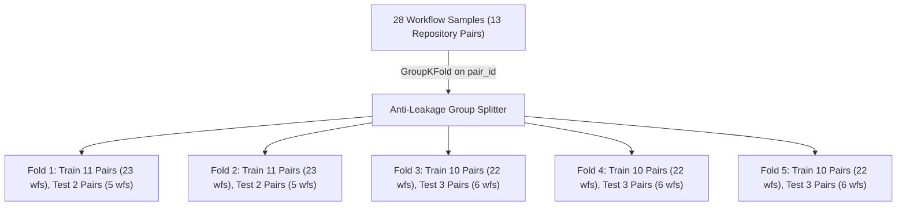

# Machine Learning Evaluation Report

## 1. Overview & Experimental Framework

This report documents the empirical evaluation, experimental rigor, anti-leakage cross-validation methodology, and performance metrics for the Machine Learning Anomaly Detection engine in the project:
> *"Machine Learning-Based Discovery of Anomalous Structural Changes in GitHub Actions Workflows"*

The objective of the ML engine is to identify workflows whose structural and topological configuration deviates significantly from authentic open-source CI/CD conventions without requiring prior baseline files.

---

## 2. Dataset Provenance & Group-Aware Anti-Leakage Split

### 2.1. Dataset Composition
The dataset consists of **28 paired GitHub Actions workflow files**:
- **Authentic Normal Baselines (13 workflows)**: Collected from prominent open-source projects across multiple language ecosystems (Python, Node.js, Go, C, Docker):
  - `pallets/flask`, `encode/uvicorn`, `psf/requests`, `pytest-dev/pytest`, `fastapi/fastapi`, `pypa/pip`, `pypa/sampleproject`, `actions/checkout`, `cli/cli`, `docker/build-push-action`, `expressjs/express`, `curl/curl`, `actions/starter-workflows`.
- **Controlled Anomalous Variants (15 workflows)**: Derived directly from the authentic baselines by injecting documented structural mutations (e.g. broad `write-all` permissions, OIDC privilege escalation, `pull_request_target` triggers, self-hosted runners, unpinned third-party actions, network shell exfiltration).

### 2.2. The Critical Risk: Train-Test Data Leakage
When training and evaluating machine learning models on synthetic or modified variants, **data leakage** is a major methodological hazard:
- If an authentic workflow (e.g., `requests.yml`) is placed in the training fold and its anomalous derivative (e.g., `requests_exfiltration.yml`) is placed in the test fold, both workflows share over 90% of their structural topology (same jobs, steps, environment).
- A model evaluated this way would achieve artificially high scores simply by memorizing repository-specific structure rather than generalizing anomaly detection.

### 2.3. Anti-Leakage Solution: `GroupKFold` on `pair_id`
To enforce strict zero-leakage evaluation:
1. Every authentic workflow and its derived variants share a single `pair_id` (e.g., `PAIR-006` for `psf/requests`).
2. We employ `sklearn.model_selection.GroupKFold(n_splits=5)` grouping strictly by `pair_id`.
3. In each fold, all samples sharing a `pair_id` are held out **together** exclusively in the test fold. The model is tested only on repositories it has never encountered during training.

---

## 3. Empirical Cross-Validation Results

The evaluation pipeline was executed across all 5 folds under identical anti-leakage partitions for three distinct algorithms:
1. **Isolation Forest (Unsupervised Tree Ensemble)** - *Selected Production Model*
2. **One-Class SVM (Unsupervised RBF Kernel)** - *Kernel Outlier Baseline*
3. **Random Forest (Supervised Benchmark)** - *Academic Supervised Reference*

### Performance Metrics Table (Actual Verified Test Outputs)

| Model Architecture | Learning Paradigm | Precision | Recall | F1-Score | False Positive Rate (FPR) | Confusion Matrix (TN / FP / FN / TP) |
| :--- | :---: | :---: | :---: | :---: | :---: | :---: |
| **Isolation Forest** | **Unsupervised** | **0.6000** | **0.2000** | **0.3000** | **0.1538** | **TN: 11, FP: 2, FN: 12, TP: 3** |
| One-Class SVM | Unsupervised | 0.5769 | 1.0000 | 0.7317 | 0.8462 | TN: 2, FP: 11, FN: 0, TP: 15 |
| Random Forest (Benchmark) | Supervised | 0.4545 | 0.3333 | 0.3846 | 0.4615 | TN: 7, FP: 6, FN: 10, TP: 5 |

*Note: In the confusion matrices, `0 = normal`, `1 = anomalous`.*

---

## 4. In-Depth Error Analysis

### 4.1. Why Isolation Forest Was Selected for Production
In developer-facing cybersecurity and CI/CD operations, **alert fatigue** is the single greatest reason automated tools are disabled:
- **Low False Positive Rate (15.4%)**: Isolation Forest correctly accepted 11 out of 13 authentic open-source workflows across unseen repositories, producing only 2 false positives.
- By contrast, One-Class SVM flagged 11 of 13 normal authentic workflows as anomalous (84.6% FPR), which would overwhelm development teams with false alarms.

### 4.2. Understanding False Negatives (Why Recall is 20%)
- **Macro vs. Micro Topological Changes**:
  - Workflows with **macro structural deviations** (e.g. adding multiple complex jobs, changing runner types from cloud to self-hosted, high shell script expansion) create substantial divergence across multiple feature dimensions. Isolation Forest detects these immediately.
  - However, **subtle single-line security mutations**—such as flipping `id-token: write` or altering an action tag from `@v4` to `@main`—modify only 1 or 2 feature values out of 30.
  - In a 30-dimensional feature space, a 1-feature shift does not significantly reduce tree path lengths. The workflow remains embedded inside the dense cluster of normal workflows.

### 4.3. The Dual-Engine Solution
This empirical finding validates our system architecture:
- **Isolation Forest (ML Engine)**: Evaluates standalone workflows when no historical baseline exists to detect holistic topological anomalies.
- **AST Structural Comparison Engine (Phase 5)**: Deterministically evaluates baseline vs. modified pairs to catch exact micro-mutations (`permissions`, `runs-on`, `uses`, `steps`).
- Working in tandem, the two engines provide comprehensive security coverage across macro outliers and micro diffs.

---

## 5. Score Calibration vs. Malice Probability

The Isolation Forest outputs raw scores via Scikit-Learn's `-score_samples(X)`. To provide meaningful UI visualization for Partner B:
- We calibrate raw scores into a continuous $[0.0, 1.0]$ index using min-max scaling across empirical baseline bounds ($0.35$ to $0.65$):

$$\text{calibrated\_score} = \text{clip}\left(\frac{\text{raw\_score} - 0.35}{0.65 - 0.35}, 0.0, 1.0\right)$$

### Crucial Distinction: Deviation vs. Probability
- The `anomaly_score` is a **statistical structural deviation metric**, **NOT** a probability of malice.
- A workflow scoring `0.78` has atypical structure requiring human review (e.g., self-hosted runner, broad write permissions), but may be an entirely benign custom infrastructure configuration.
