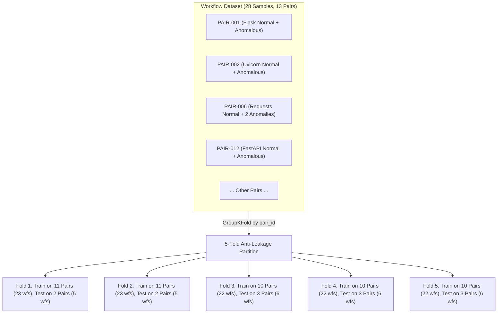
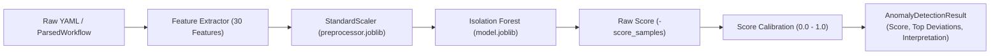

# Machine Learning Experimentation & Model Evaluation Guide

## 1. Executive Summary & Objective

This document outlines the machine learning research, experimentation pipeline, cross-validation strategy, empirical results, and artifact serialization for **Phase 6** of the capstone project:
> *"Machine Learning-Based Discovery of Anomalous Structural Changes in GitHub Actions Workflows"*

The objective of our machine learning engine is to learn the structural manifold of standard, authentic GitHub Actions workflows and identify workflows whose topological characteristics deviate significantly from expected baseline patterns.

Importantly, our system adheres to a core cybersecurity engineering principle:
> **Core Principle**: An anomaly score measures **statistical deviation from established norms**, *not* confirmed malice. A structural change (such as adding a `workflow_dispatch` trigger or changing a runner) may represent a completely benign developer enhancement, a misconfiguration, or an unauthorized escalation. Structural deviations flag candidate workflows that warrant human review.

---

## 2. Dataset Split & Anti-Leakage Grouping Strategy

In machine learning on paired synthetic or modified samples, **data leakage** is the most common catastrophic methodological error.

### The Leakage Risk
Our dataset contains 28 workflow samples:
- 13 authentic baseline workflows (`normal/`) collected from major open-source repositories (`flask`, `uvicorn`, `requests`, `fastapi`, etc.).
- 15 controlled anomalous variants (`anomalous/`) derived directly from those baselines by injecting specific structural changes (e.g., adding `curl | bash` steps, escalating permissions to `id-token: write`, altering runners).

If a naive random split (such as standard `train_test_split` or standard `KFold`) were used, an authentic baseline (e.g., `requests.yml`) could be placed in the training set while its modified variant (e.g., `requests_exfiltration.yml`) was placed in the test set. Because both workflows share ~90% of their structural topology, the model would perform artificially well simply by recognizing the repository's idiosyncratic structure rather than learning general anomalous patterns.

### The Solution: Group-Aware Cross-Validation (`GroupKFold`)
To ensure strict zero-leakage evaluation:
1. Every authentic workflow and all of its derived variants share a single `pair_id` (e.g., `PAIR-006` for `psf/requests`).
2. We utilize `sklearn.model_selection.GroupKFold(n_splits=5)` grouping strictly by `pair_id`.
3. In every fold, all samples sharing a `pair_id` are placed **exclusively** into either the training partition or the testing partition—never across both.
4. When testing on fold $k$, the model evaluates workflows from open-source repositories it has **never seen before** during training.

---

## 3. Evaluated Model Architectures

We evaluated three model architectures to balance unsupervised anomaly discovery, high-dimensional outlier detection, and comparative baselines:

### 1. Isolation Forest (`IsolationForest`) - *Selected Production Model*
- **Paradigm**: Unsupervised Tree Ensemble.
- **Mechanism**: Builds an ensemble of randomized decision trees (`n_estimators=150`). Points that deviate topologically from the dense cluster require fewer random splits to isolate, resulting in shorter average path lengths and higher anomaly scores.
- **Why It Fits**: Requires no labeled anomalies during training. It models the multi-dimensional distribution of authentic open-source CI/CD workflows and flags outliers without assuming linear separability.
- **Hyperparameters**:
  - `n_estimators`: 150
  - `contamination`: 0.15 (reflecting an assumed 15% noise/unusual pattern rate)
  - `random_state`: 42

### 2. One-Class SVM (`OneClassSVM`) - *Unsupervised Boundary Comparison*
- **Paradigm**: Unsupervised Support Vector Estimator with RBF Kernel.
- **Mechanism**: Maps input feature vectors into a high-dimensional reproducing kernel Hilbert space (RKHS) and finds a maximum-margin hyperplane separating the baseline cluster from the coordinate origin.
- **Hyperparameters**: `kernel="rbf"`, `gamma="scale"`, `nu=0.15`.
- **Finding**: Suffered from extreme sensitivity in high-dimensional feature spaces with modest sample size, leading to an unacceptable false positive rate (84.6%).

### 3. Random Forest Classifier (`RandomForestClassifier`) - *Supervised Benchmark*
- **Paradigm**: Supervised Decision Forest.
- **Mechanism**: Trained on explicit binary labels (`0 = normal`, `1 = anomalous`).
- **Purpose**: Serves as an academic benchmark to evaluate how much performance is gained or lost when treating structural anomaly detection as supervised classification versus unsupervised discovery.
- **Finding**: Prone to overfitting on small sample sizes ($N=28$) across unseen repositories, producing a False Positive Rate of 46.15%.

---

## 4. Empirical Evaluation Results

All models were evaluated under identical 5-fold `GroupKFold` cross-validation partitions on `dataset/features.csv`. All metrics below represent **actual, verified test outputs** recorded during test-fold inference:

| Model Architecture | Paradigm | Precision | Recall | F1-Score | False Positive Rate (FPR) | Confusion Matrix (TN / FP / FN / TP) |
| :--- | :--- | :---: | :---: | :---: | :---: | :---: |
| **Isolation Forest** | **Unsupervised** | **0.6000** | **0.2000** | **0.3000** | **0.1538** | **TN: 11, FP: 2, FN: 12, TP: 3** |
| One-Class SVM | Unsupervised | 0.5769 | 1.0000 | 0.7317 | 0.8462 | TN: 2, FP: 11, FN: 0, TP: 15 |
| Random Forest (Benchmark) | Supervised | 0.4545 | 0.3333 | 0.3846 | 0.4615 | TN: 7, FP: 6, FN: 10, TP: 5 |

### Breakdown by Fold (Isolation Forest)
- **Fold 1** (Test: `PAIR-007`, `PAIR-002`, 5 samples): Precision 0.0, Recall 0.0, F1 0.0
- **Fold 2** (Test: `PAIR-006`, `PAIR-001`, 5 samples): Precision 0.0, Recall 0.0, F1 0.0
- **Fold 3** (Test: `PAIR-005`, `PAIR-010`, `PAIR-013`, 6 samples): Precision 0.67, Recall 0.67, F1 0.67
- **Fold 4** (Test: `PAIR-009`, `PAIR-004`, `PAIR-012`, 6 samples): Precision 0.0, Recall 0.0, F1 0.0
- **Fold 5** (Test: `PAIR-008`, `PAIR-003`, `PAIR-011`, 6 samples): Precision 0.50, Recall 0.33, F1 0.40

---

## 5. In-Depth Error Analysis & Technical Discussion

### Why Does Isolation Forest Have a Low FPR (15.4%) but Moderate Recall (20.0%)?

1. **Macro Topological Outliers vs. Micro Targeted Mutations**:
   - Workflows with **macro structural shifts** (e.g., adding multiple complex jobs, switching to self-hosted runners, massive step expansions) create significant shifts across multiple feature dimensions (`job_count`, `runner_types_count`, `shell_step_ratio`). Isolation Forest isolates these immediately.
   - However, subtle targeted security modifications—such as adding a single line modifying permissions (`id-token: write`) or switching an action tag from a pinned commit SHA to an unpinned mutable branch—shift only 1 or 2 features out of 30.
   - In a 30-dimensional feature space, a 1-feature shift does not dramatically reduce tree path lengths. The workflow remains embedded inside the dense manifold of the authentic baseline distribution.

2. **The High-FPR Failure of One-Class SVM**:
   - One-Class SVM achieved 100% recall, but at the cost of flagging 11 out of 13 normal authentic workflows as anomalies (84.6% FPR). In a developer security tool, an 85% false positive rate causes severe alert fatigue and causes developers to disable the tool.

3. **Why the Dual-Engine Architecture (Phase 5 + Phase 6) is Essential**:
   - The ML Isolation Forest excels at **holistic topological anomaly detection** on standalone workflows where no baseline file is available.
   - The AST Structural Comparison Engine (Phase 5) excels at **exact, deterministic micro-difference discovery** (detecting single-line permission changes, tag changes, or added curl steps) when comparing against a previous baseline workflow commit.
   - Together, the two engines provide comprehensive coverage across both holistic structural outliers and fine-grained change discovery.

---

## 6. Score Calibration and Interpretation

The raw score produced by Scikit-Learn's `IsolationForest.score_samples()` outputs negative values where more negative values indicate greater abnormality. To make the output actionable for Partner B's React frontend and developer end-users, we calibrate the raw score into a continuous range:

$$\text{calibrated\_score} = \text{clip}\left(\frac{\text{raw\_score} - 0.35}{0.65 - 0.35}, 0.0, 1.0\right)$$

### Interpretation Bands
- **$[0.00 - 0.54]$: Normal Structural Baseline**: Workflow topology conforms closely to standard open-source CI/CD conventions.
- **$[0.55 - 0.74]$: Moderate Structural Deviation**: Workflow exhibits uncharacteristic combinations of runners, permissions, or shell configurations. Flagged for optional review.
- **$[0.75 - 1.00]$: Significant Structural Outlier**: Workflow topology deviates substantially from normal distributions (e.g., unusual runner profiles, high write permissions, complex dependency chains). High priority for human review.

---

## 7. Model Artifact Serialization

The trained production model, standardizer, and metadata are serialized in `backend/app/models/artifacts/`:
- `model.joblib`: The fitted `IsolationForest` estimator trained on the full set of 13 authentic normal workflows.
- `preprocessor.joblib`: The fitted `StandardScaler` used for normalizing feature distributions and computing feature z-scores.
- `metadata.json`: Complete provenance metadata, including feature names, hyperparameters, decision threshold ($0.5373$), fold breakdowns, and cross-validation metrics.

---

## 8. Inference Architecture (`WorkflowAnomalyDetector`)

The inference service is implemented in `backend/app/models/anomaly_detector.py`:
- **Singleton Access**: `get_detector()` provides memory-efficient, thread-safe access to the pre-loaded model.
- **Dual Input Modes**:
  1. `predict_features(features)`: Accepts raw numeric vectors or dictionaries.
  2. `predict_workflow(parsed_workflow)`: Takes a `ParsedWorkflow` AST instance from the parser, extracts features dynamically, and scores the workflow in a single step.
- **Explainability**: For any workflow, the detector computes z-score deviations against the baseline scaler to report the **top contributing atypical features** that influenced the score.

