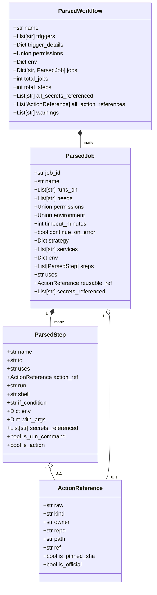

# Safe YAML Workflow Parser Guide

## 1. Overview
The **GitHub Actions Workflow Parser** (`backend/app/parser/`) is the foundational security and structural extraction layer of our backend. Its primary responsibility is to ingest untrusted YAML files submitted by users, validate their structural integrity, and produce an immutable, standardized representation (`ParsedWorkflow`) without executing any code.

---

## 2. Cybersecurity & Safe Parsing Principles

### 2.1 The Danger of `yaml.load()` vs. `yaml.safe_load()`
Standard YAML allows type tags that describe arbitrary object instantiation. In standard Python PyYAML:
- `yaml.load()` allows tags like `!!python/object/apply:os.system ['rm -rf /']` or `!!python/module:...`. An attacker submitting a crafted YAML payload can achieve **Remote Code Execution (RCE)** on the server immediately upon file upload.
- **`yaml.safe_load()`** resolves only standard YAML primitives (strings, integers, floats, booleans, lists, and dictionaries). It explicitly disallows custom constructors and raises `yaml.constructor.ConstructorError` if any non-standard tag is encountered.

### 2.2 Why Uploaded Workflows Must Never Be Executed
In CI/CD security, workflow YAMLs frequently contain embedded shell scripts in `run:` blocks, such as:
```yaml
- name: Build
  run: |
    npm install
    curl -fsSL https://... | bash
    make release
```
Our machine learning platform is strictly an **analysis-only system**:
1. All shell commands in `run:` blocks are treated purely as **inert text**.
2. Neither `subprocess`, `os.system`, nor any shell runner is ever invoked on workflow contents.
3. Workflows are never dispatched or triggered against GitHub repositories or remote runners.

### 2.3 Defense-in-Depth Measures Implemented
- **Payload Size Ceiling**: Files exceeding 1 MB (1,048,576 bytes) are rejected immediately to prevent memory-exhaustion Denial-of-Service (DoS) attacks.
- **Root Mapping Enforcement**: GitHub Actions workflows must have a dictionary as the root element. Non-dictionary roots (e.g. uploaded lists, numbers, or bare strings) are rejected with clear error messages.
- **Character Encoding Guard**: Payloads are strictly decoded as UTF-8.
- **YAML 1.1 Boolean Quirk Normalization**: Under the YAML 1.1 specification implemented by PyYAML, unquoted `on:` parses as boolean `True`. Our parser transparently normalizes this key back to `"on"`.

---

## 3. Data Models Architecture



---

## 4. Key Extraction Capabilities

1. **Trigger Analysis**: Normalizes triggers from strings (`on: push`), lists (`on: [push, pull_request]`), or structured maps with branch/path filters.
2. **Permission Scopes**: Extracts top-level and job-level permissions, distinguishing between broad grants (`permissions: write-all`) and granular resource dictionaries (`permissions: { contents: read, id-token: write }`).
3. **Runner Configuration**: Normalizes `runs-on` into string lists, detecting standard GitHub-hosted tags (`ubuntu-latest`, `windows-latest`) vs. private or self-hosted pools (`[self-hosted, linux]`).
4. **Action Categorization & SHA Pinning**: Analyzes `uses:` strings to identify:
   - Official actions (`actions/*`, `github/*`)
   - Third-party community actions
   - Docker container actions (`docker://...`)
   - Local actions (`./...`)
   - Reusable workflows (`owner/repo/.github/workflows/...`)
   - **Full 40-character commit SHA pinning** (`^[0-9a-fA-F]{40}$`) vs. floating branch/version tags (`@v4`, `@main`).
5. **Secret Reference Detection**: Scans `env`, `with`, `run`, and `if` blocks for references matching `secrets.<NAME>` or `${{ secrets.<NAME> }}`.

---

## 5. Verification & Testing

The parser is verified by 14 targeted unit tests in `backend/tests/test_parser.py`:
- `test_empty_and_whitespace_yaml`: Ensures empty inputs are rejected cleanly.
- `test_comment_only_yaml`: Ensures comment-only files are handled.
- `test_malformed_syntax_yaml`: Checks invalid syntax and tab indentation errors.
- `test_payload_size_limit`: Confirms rejection of payloads > 1MB.
- `test_unexpected_root_types`: Validates rejection of non-dict roots.
- `test_safe_parsing_blocks_unsafe_deserialization`: Confirms code injection tags fail safely.
- `test_shell_commands_never_executed`: Proves shell script strings are stored inertly.
- `test_unquoted_on_boolean_normalization`: Tests YAML 1.1 `on:` boolean normalization.
- `test_trigger_formats`: Tests string, list, and map trigger normalization.
- `test_action_reference_parsing`: Tests pinning, official status, docker, and reusable workflows.
- `test_secret_reference_extraction`: Tests multi-scope secret extraction.
- `test_complex_job_structures`: Tests dependencies, matrix, timeouts, environments.
- `test_parse_authentic_dataset_workflows`: Parses all 13 authentic workflows in `dataset/normal/`.
- `test_parse_anomalous_dataset_workflows`: Parses all 15 anomalous workflows in `dataset/anomalous/`.
